# Caja de Kiosco · App de caja, cuentas y mercancía para un pequeño negocio

App para el celular que reemplaza **la calculadora y el cuaderno** con los que dos socias cerraban la caja de su kiosco cada noche.
Responden unas pocas preguntas y la app les dice cuánto vendieron, **cuánto le toca a cada una** y cómo separar el dinero para compras,
pagos del mes y gas. Con el tiempo, además, **aprende cuánta mercancía conviene llevar cada día** para que vuelva menos a casa.
Funciona **sin internet**, se instala como una app y **no tiene costo de servidor**.

> El código es privado. Este repositorio muestra el proyecto con **datos y nombres inventados**.

  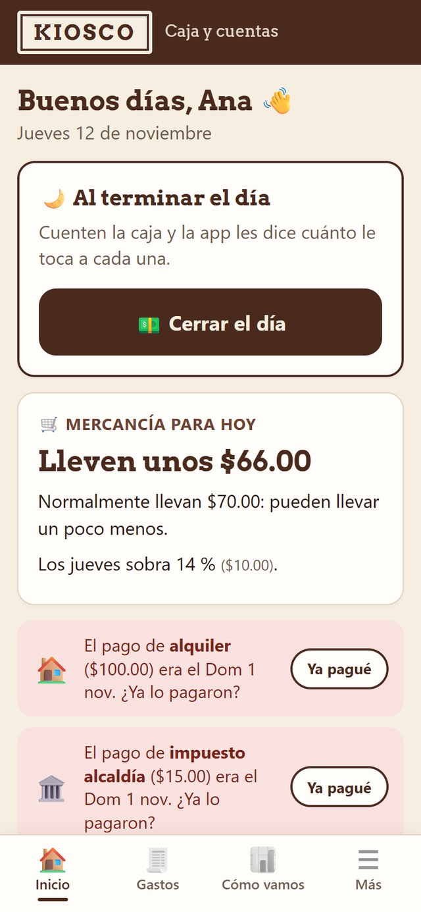
  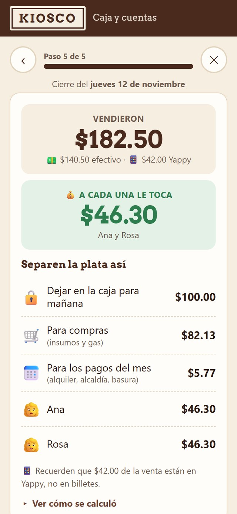
  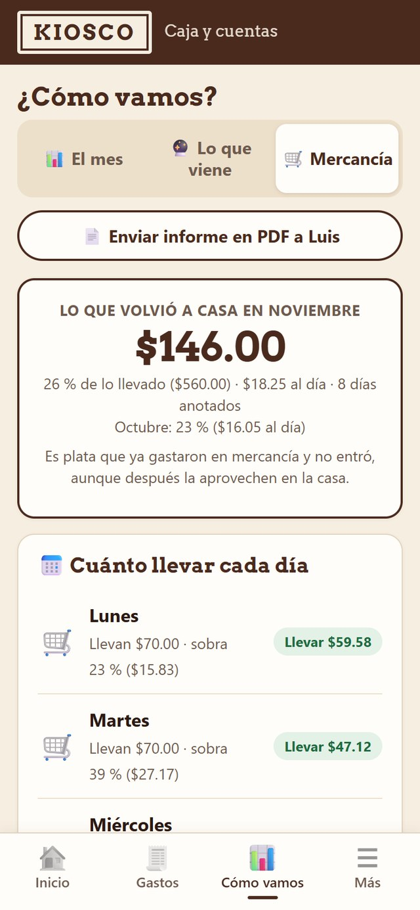

## El problema

En un negocio pequeño, el cierre diario se hacía a mano: contar billetes, restar el fondo de caja, sumar lo que entró por
transferencia, apartar lo de las compras y el alquiler, y recién entonces repartir lo que quedaba. Eran cuentas de varios pasos,
cada noche y con cansancio, lo que llevaba a errores, dudas sobre el reparto y pagos fijos que llegaban sin el dinero apartado.

Había además un segundo problema, más difícil de ver: **algunos días volvía mercancía a la casa**. Eso es plata que se gastó y no
entró, y no había forma de saber qué días convenía llevar más o menos ni si lo que se apartaba para comprar era suficiente.

Las usuarias **no son técnicas**, así que la solución tenía que ser tan simple como contestar preguntas.

## Qué hace

| Función | Para qué sirve |
|---|---|
| **Cerrar el día en pocas preguntas** | Efectivo en caja, pagos por transferencia (Yappy), gastos pagados con la caja y mercancía llevada y devuelta. La app hace el resto. |
| **Reparto automático** | Calcula cuánto le toca a cada socia según los porcentajes acordados. |
| **Cómo separar el dinero** | Fondo para mañana, compras e insumos, y lo que se aparta cada día para los pagos del mes. |
| **Mercancía llevada y devuelta** | Se anota cuánto costó lo que llevaron y cuánto volvió, con tres marcas: se acabó antes de cerrar, llovió, hubo feria. |
| **Sugerencia de cuánto llevar** | «Lleven unos $66»: aprende de cada día de la semana y se ajusta si ese día suele acabarse todo. |
| **¿Alcanza lo que apartan?** | Compara lo que realmente gastan en mercancía y gas con el porcentaje que apartan para compras, y dice cuánto sobra o falta. |
| **Presupuesto de la semana** | Suma lo sugerido para los próximos días de trabajo y lo compara con la plata apartada. |
| **Lo que rinde** | «Por cada $1 de mercancía que usan, venden $2.41»: sirve para revisar precios. |
| **Gastos con un toque** | Gas, compras, alquiler, impuestos, basura, taxi u otros. Cada uno sale del apartado que le corresponde. |
| **Control del gas** | Aprende cuánto dura cada cilindro y avisa cuándo toca el próximo. |
| **¿Cómo vamos?** | Ventas del mes, mejores días de la semana, efectivo frente a transferencias y comparación con el mes anterior. |
| **Informe en PDF** | Resumen mensual con una sección de mercancía y su variación frente al mes anterior, listo para mandar por WhatsApp. |
| **Copias de seguridad** | Respaldo en un archivo para guardar en Google Drive o WhatsApp, y restauración en otro teléfono. |
| **Actualización por sí misma** | Avisa «Hay una versión nueva» y se actualiza con un toque, sin ayuda de quien la desarrolló. |

## Cómo se usa

**1. Cada noche: «Cerrar el día».** Cuentan la caja, anotan lo que entró por Yappy y lo que se pagó con la caja.

  
  

**2. Anotan la mercancía.** Un paso más: cuánto costó lo que llevaron, cuánto volvió y si se acabó, llovió o hubo feria.
Si un día no pueden, lo saltan y las cuentas quedan igual.

  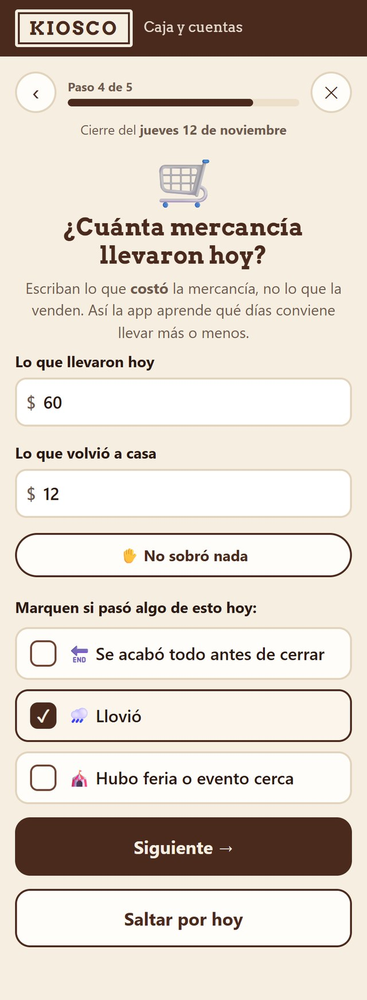

**3. Cuando pagan algo**, tocan el gasto y escriben el monto.

**4. Para ver cómo va el negocio**, entran a «¿Cómo vamos?»: el mes, la mercancía y lo que viene.

  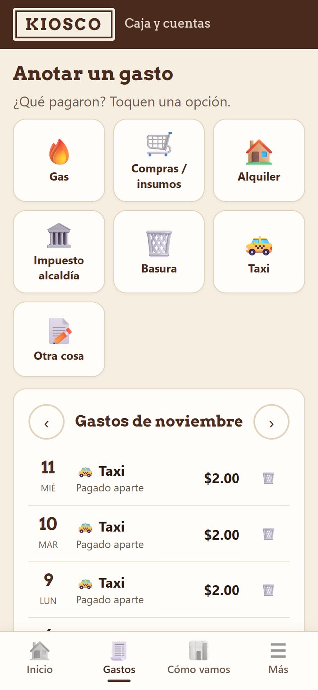
  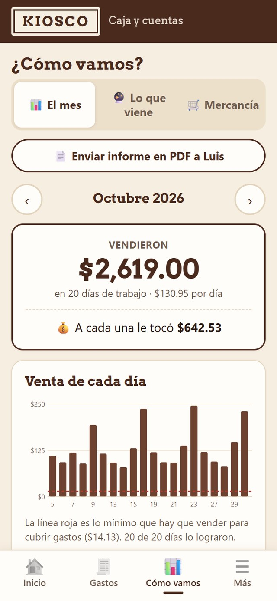
  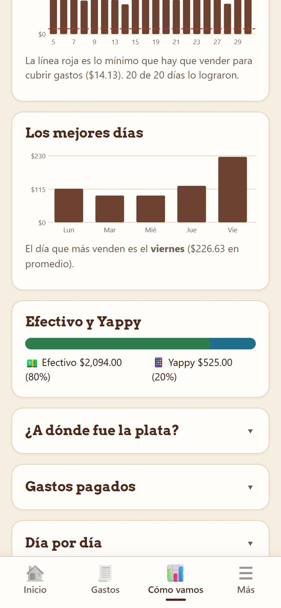

## Aprende con lo que se anota

La app no «adivina»: calcula con lo que las usuarias anotan, y es clara sobre lo que todavía no sabe.

  
  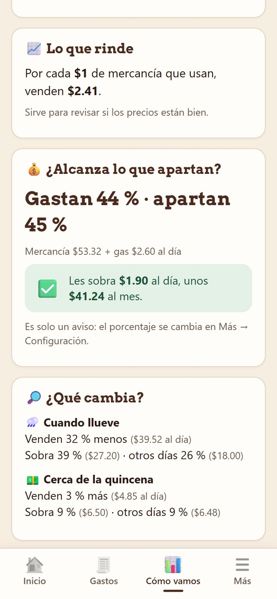
  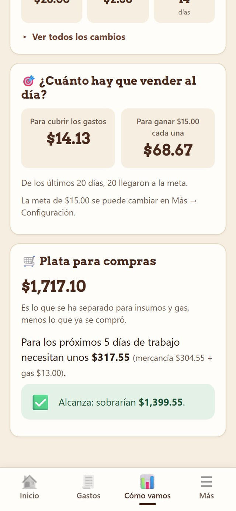

| Pregunta | Cómo la responde |
|---|---|
| ¿Cuánto llevar un martes? | Promedio de lo que realmente se usó ese día de la semana (llevado − lo que volvió) más un colchón del 10 %; del 20 % si en 1 de cada 3 de esos días se acabó todo. |
| ¿Cuándo da la sugerencia? | Solo cuando hay al menos 3 días anotados de ese día de la semana. Antes muestra una barra de avance, no un número inventado. |
| ¿Qué cambia con la lluvia, una feria o la quincena? | Compara cada día con marca contra **días iguales sin la marca** (un viernes de feria contra viernes normales), para no confundir la feria con el efecto del viernes. |
| ¿Alcanza lo que apartan para compras? | Gasto real (mercancía usada + gas por día de trabajo) frente al porcentaje apartado. **Solo informa**: el porcentaje lo cambian las socias. |
| ¿Cuánto comprar esta semana? | Suma lo sugerido de los próximos días de trabajo + gas, frente a la plata apartada. Solo se muestra si todos esos días ya tienen sugerencia. |

Junto a cada porcentaje, la app muestra en letra pequeña **cuánto es en dinero**, porque un «14 %» no le dice mucho a quien lleva el negocio.

  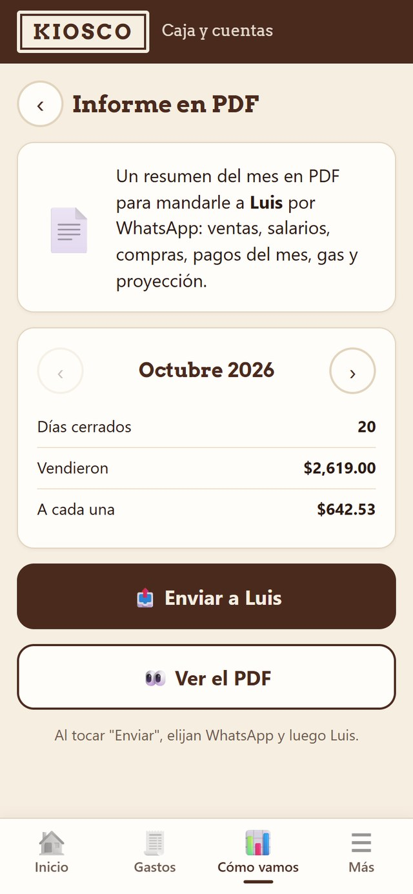
  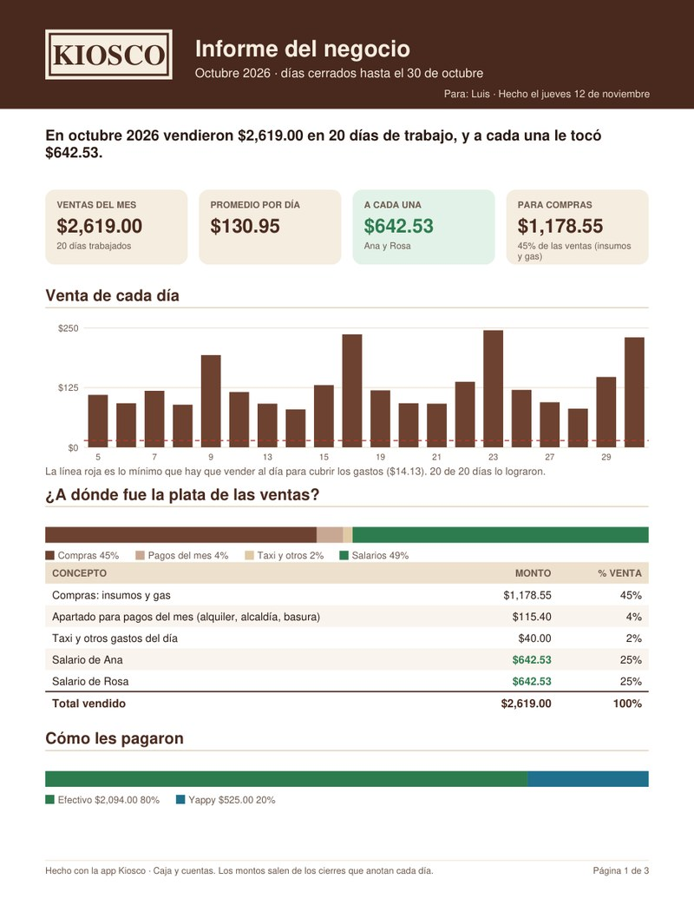
  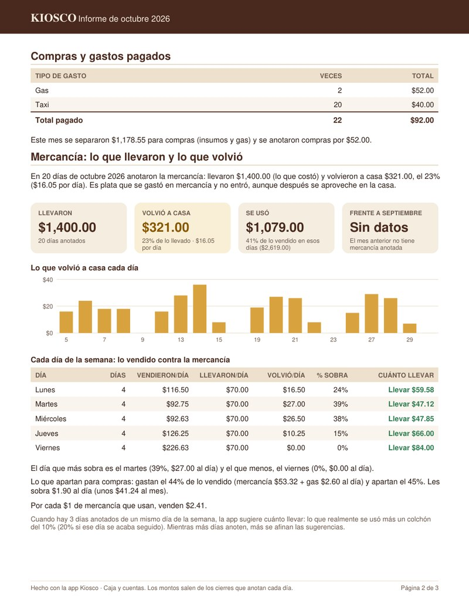

## Cómo hace las cuentas del cierre

| Paso | Cálculo |
|---|---|
| Venta del día | (efectivo en caja − fondo inicial + lo pagado con la caja) + transferencias |
| Compras e insumos | Un porcentaje configurable de la venta (incluye el gas) |
| Apartado para pagos fijos | Suma de los pagos del mes ÷ días de trabajo del mes |
| Gastos del día | Taxi y otros gastos sueltos |
| **Para salarios** | Lo que queda, repartido según el porcentaje de cada socia |

Anotar la mercancía **no cambia** estas cuentas: lo que vuelve se muestra aparte, como plata que salió y no entró.

## Decisiones de diseño

- **Pensada para personas no técnicas.** Textos grandes, botones grandes con texto (no solo íconos), una pregunta por pantalla,
  lenguaje del día a día («¿Cuánto efectivo hay en la caja?») y avisos solo cuando hace falta.
- **Sin servidor y sin internet.** Es una app web instalable (PWA): se guarda en el teléfono y funciona sin conexión.
  Los datos nunca salen del celular, no hay cuentas ni contraseñas y el costo de operación es **cero**.
- **Honesta con los datos.** Mientras no hay suficiente información no da sugerencias: muestra cuántos días faltan. Las
  comparaciones se hacen contra días iguales, y lo que es solo un aviso (como «¿alcanza lo que apartan?») no cambia nada solo.
- **Se actualiza sola.** Quien la usa recibe el aviso «Hay una versión nueva» y la actualiza con un toque. Antes, cada cambio
  dependía de que alguien la actualizara por ella.
- **Copias de seguridad guiadas.** Como los datos viven en el teléfono, la app recuerda cada semana guardar una copia y permite
  restaurarla en otro equipo.
- **El informe se comparte donde ya están las usuarias:** WhatsApp, con el menú de compartir del propio teléfono.
- **Probada antes de publicar.** La lógica de las sugerencias tiene 39 pruebas automáticas hechas antes que el código; si
  alguna falla, la publicación se detiene.
- **Publicación separada del código.** El código vive en un repositorio privado y una acción automática publica solo los archivos
  de la app en el sitio público, revisando antes que no se cuelen datos personales.

  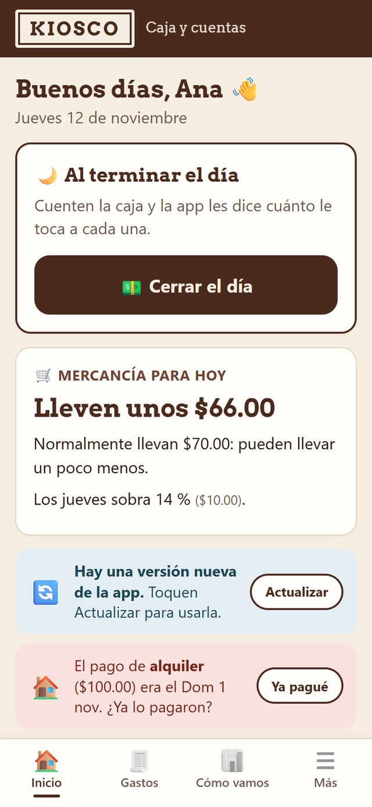

## Tecnologías

- **HTML, CSS y JavaScript** sin frameworks (carga instantánea en teléfonos sencillos)
- **PWA**: *service worker* para el uso sin internet y el aviso de versión nueva, y *manifest* para instalarla con su ícono
- **localStorage** para guardar los datos en el teléfono
- **jsPDF** para generar el informe mensual en el propio celular
- **Web Share API** para enviar el PDF y las copias por WhatsApp
- **Vitest** para las pruebas automáticas de la lógica de negocio
- **GitHub Actions + GitHub Pages** para correr las pruebas y publicar de forma automática

## Contacto

- LinkedIn: [linkedin.com/in/jordandiax](https://www.linkedin.com/in/jordandiax/)
- GitHub: [github.com/JordanDiaz07](https://github.com/JordanDiaz07)
- Teléfono: +507 6396-5192
