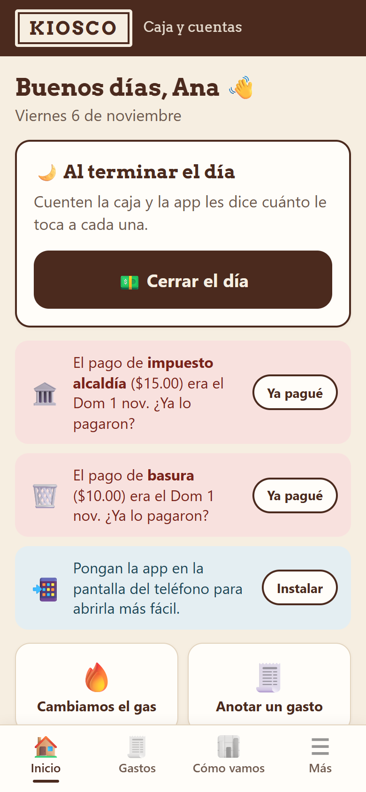
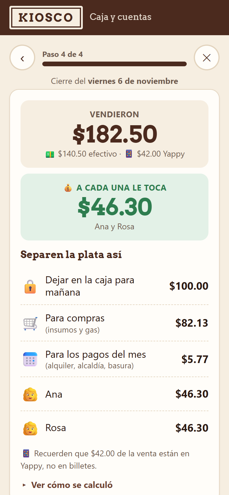
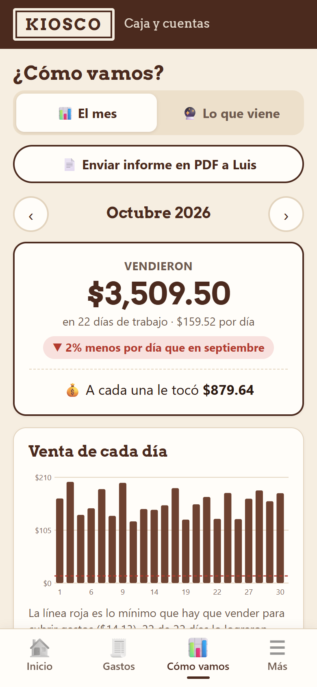
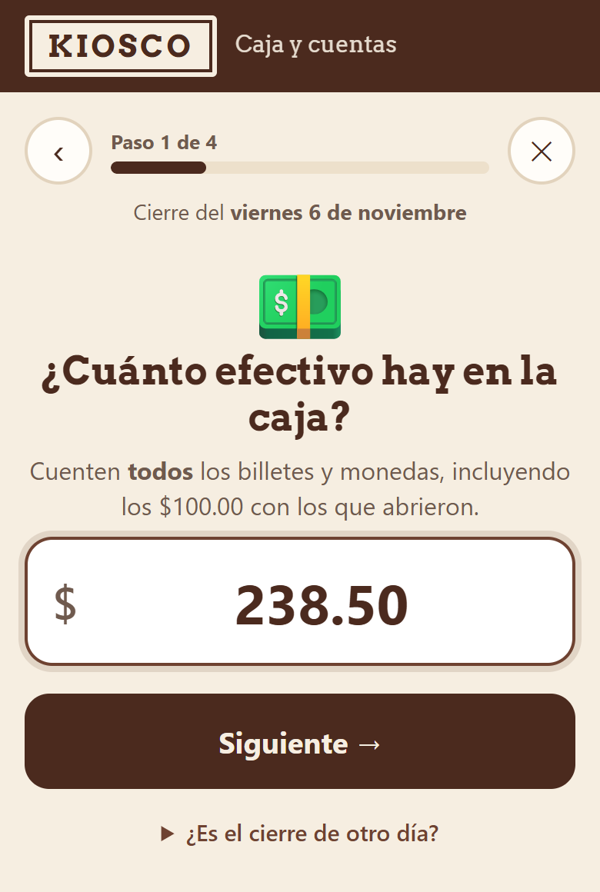
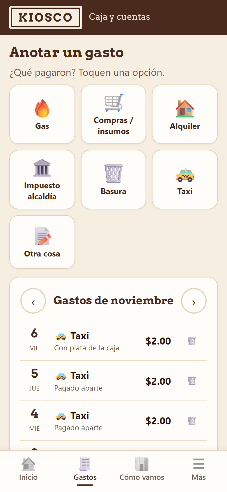
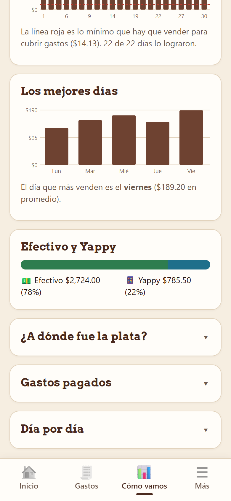
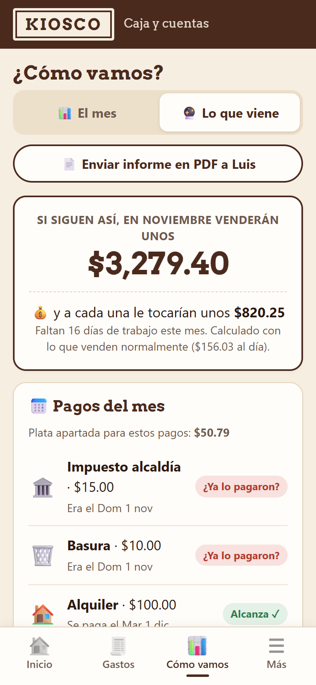
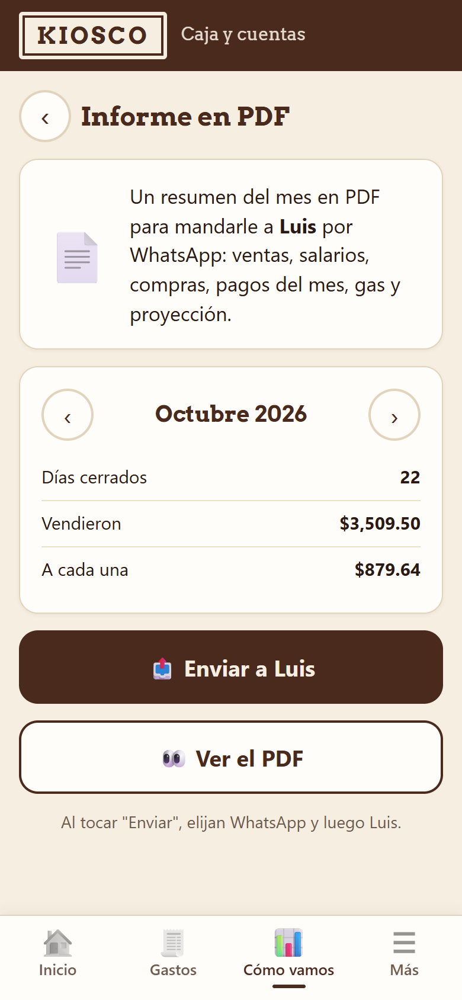
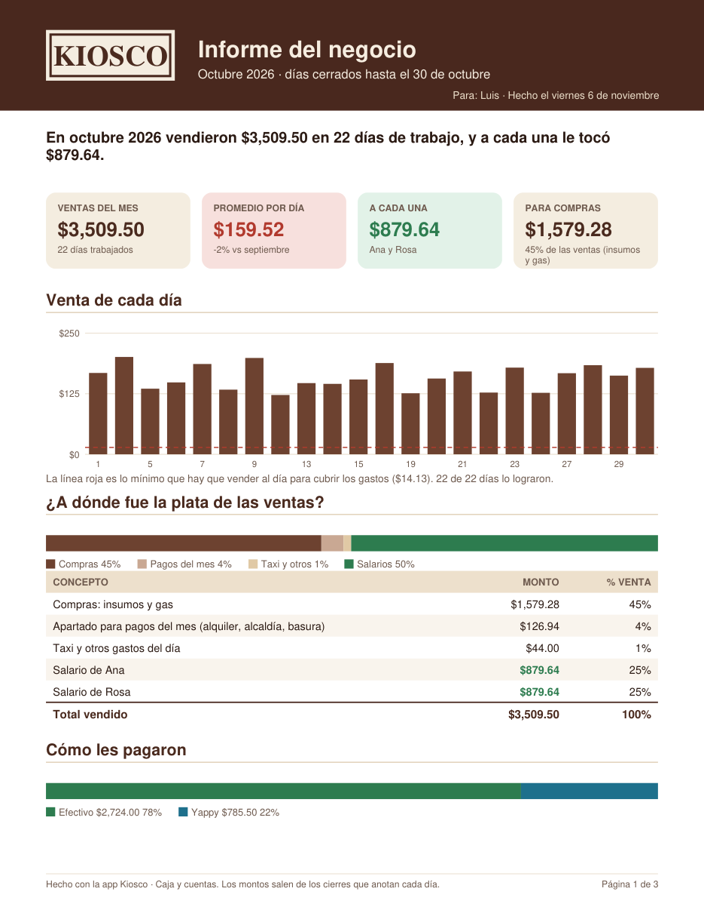

# Caja de Kiosco · App de caja y cuentas para un pequeño negocio

App para el celular que reemplaza **la calculadora y el cuaderno** con los que dos socias cerraban la caja de su kiosco cada noche.
Responden **3 preguntas** y la app les dice cuánto vendieron, **cuánto le toca a cada una** y cómo separar el dinero para compras,
pagos del mes y gas. Funciona **sin internet**, se instala como una app y **no tiene costo de servidor**.

> El código es privado. Este repositorio muestra el proyecto con **datos y nombres inventados**.

  
  
  

## El problema

En un negocio pequeño, el cierre diario se hacía a mano: contar billetes, restar el fondo de caja, sumar lo que entró por
transferencia, apartar lo de las compras y el alquiler, y recién entonces repartir lo que quedaba. Eran cuentas de varios pasos,
cada noche y con cansancio, lo que llevaba a errores, dudas sobre el reparto y pagos fijos que llegaban sin el dinero apartado.

Las usuarias **no son técnicas**, así que la solución tenía que ser tan simple como contestar preguntas.

## Qué hace

| Función | Para qué sirve |
|---|---|
| **Cerrar el día en 3 preguntas** | Efectivo en caja, pagos por transferencia (Yappy) y gastos pagados con la caja. La app hace el resto. |
| **Reparto automático** | Calcula cuánto le toca a cada socia según los porcentajes acordados. |
| **Cómo separar el dinero** | Fondo para mañana, compras e insumos, y lo que se aparta cada día para los pagos del mes. |
| **Gastos con un toque** | Gas, compras, alquiler, impuestos, basura, taxi u otros. Cada uno sale del apartado que le corresponde. |
| **Control del gas** | Aprende cuánto dura cada cilindro y avisa cuándo toca el próximo. |
| **Avisos** | Solo cuando hace falta: un pago que vence, un día sin cerrar o una copia de seguridad pendiente. |
| **¿Cómo vamos?** | Ventas del mes, mejores días de la semana, efectivo frente a transferencias y comparación con el mes anterior. |
| **Lo que viene** | Proyección del mes y si el dinero apartado alcanza para cada pago fijo. |
| **Informe en PDF** | Resumen mensual de 3 páginas listo para mandar por WhatsApp a quien lleva las cuentas. |
| **Copias de seguridad** | Respaldo en un archivo para guardar en Google Drive o WhatsApp, y restauración en otro teléfono. |
| **Carga de meses anteriores** | Día por día o con una plantilla de Excel (CSV), para que las proyecciones arranquen con historia. |

## Cómo se usa

**1. Cada noche: «Cerrar el día».** Cuentan la caja y escriben el total.

  
  

**2. Cuando pagan algo**, tocan el gasto y escriben el monto.

**3. Para ver cómo va el negocio**, entran a «¿Cómo vamos?»: el mes, los gráficos y la proyección.

  
  
  

**4. A fin de mes**, mandan el informe en PDF con un toque.

  
  

## Cómo hace las cuentas

| Paso | Cálculo |
|---|---|
| Venta del día | (efectivo en caja − fondo inicial + lo pagado con la caja) + transferencias |
| Compras e insumos | Un porcentaje configurable de la venta (incluye el gas) |
| Apartado para pagos fijos | Suma de los pagos del mes ÷ días de trabajo del mes |
| Gastos del día | Taxi y otros gastos sueltos |
| **Para salarios** | Lo que queda, repartido según el porcentaje de cada socia |

Montos, porcentajes, días de trabajo, fechas de pago y nombres se cambian desde la propia app.

## Decisiones de diseño

- **Pensada para personas no técnicas.** Textos grandes, botones grandes con texto (no solo íconos), una pregunta por pantalla,
  lenguaje del día a día («¿Cuánto efectivo hay en la caja?») y avisos solo cuando hace falta.
- **Sin servidor y sin internet.** Es una app web instalable (PWA): se guarda en el teléfono y funciona sin conexión.
  Los datos nunca salen del celular, no hay cuentas ni contraseñas y el costo de operación es **cero**.
- **Copias de seguridad guiadas.** Como los datos viven en el teléfono, la app recuerda cada semana guardar una copia y permite
  restaurarla en otro equipo.
- **El informe se comparte donde ya están las usuarias:** WhatsApp, con el menú de compartir del propio teléfono.
- **Publicación separada del código.** El código vive en un repositorio privado y una acción automática publica solo los archivos de
  la app en el sitio público, revisando antes que no se cuelen datos personales.

## Tecnologías

- **HTML, CSS y JavaScript** sin frameworks (carga instantánea en teléfonos sencillos)
- **PWA**: *service worker* para el uso sin internet y *manifest* para instalarla con su ícono
- **localStorage** para guardar los datos en el teléfono
- **jsPDF** para generar el informe mensual en el propio celular
- **Web Share API** para enviar el PDF y las copias por WhatsApp
- **GitHub Actions + GitHub Pages** para la publicación automática

## Contacto

- LinkedIn: [linkedin.com/in/jordandiax](https://www.linkedin.com/in/jordandiax/)
- GitHub: [github.com/JordanDiaz07](https://github.com/JordanDiaz07)
- Teléfono: +507 6396-5192
